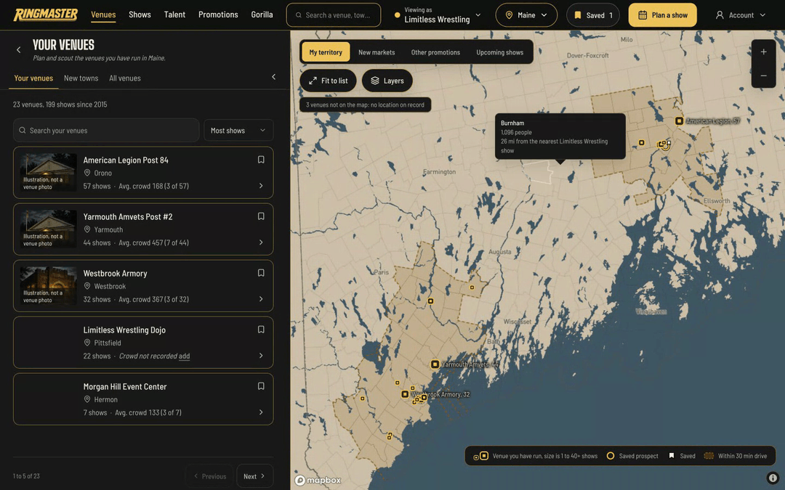
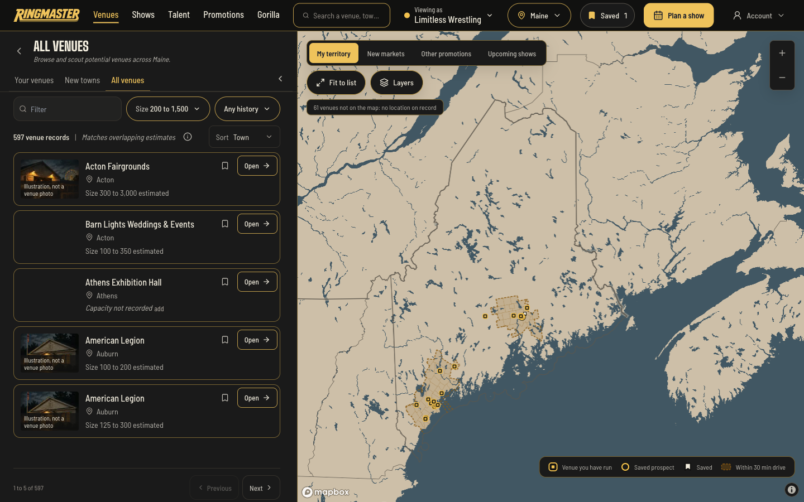
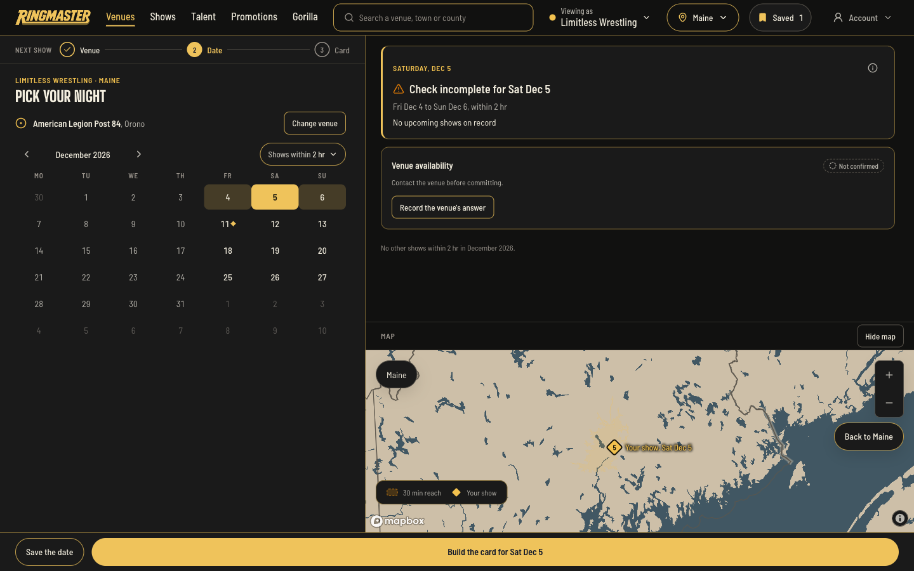
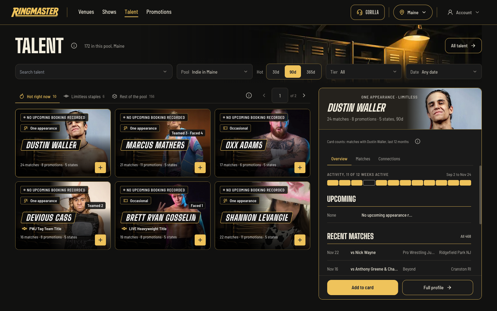
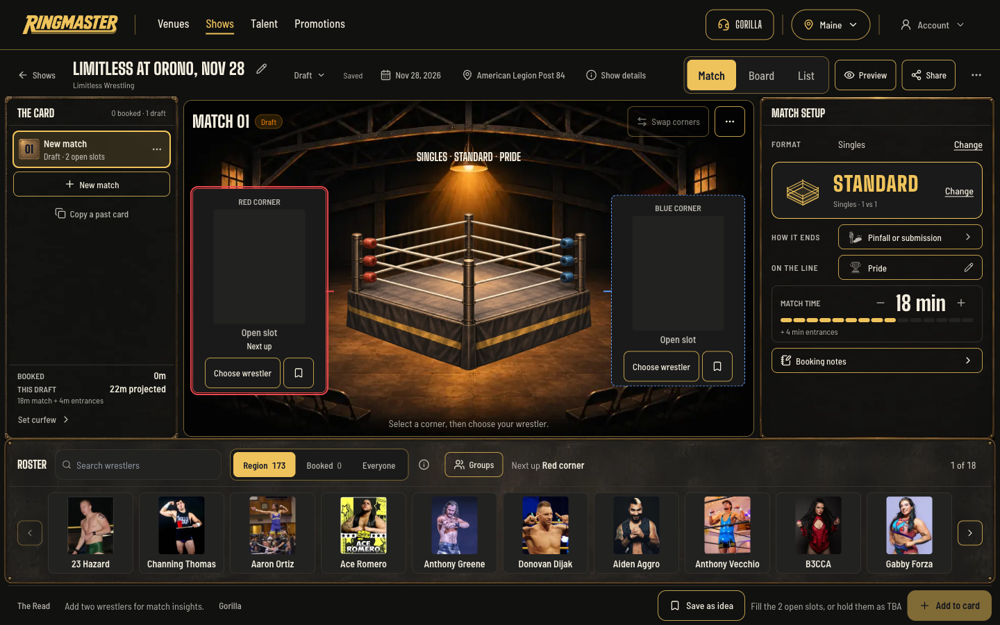

# Ringmaster

**Data tools for independent pro wrestling promoters: where to run, who's free, and how to build the card.**

Demo on request · Built in Maine with a working promoter · Code is private, this repo is the walkthrough

## The problem

Indie wrestling promoters book everything by hand. Venues live in their heads, talent availability lives in group texts, and nobody can see that another company is running 20 minutes away the same night until the tickets don't sell.

The data exists. It's scattered across results databases, promotion websites, streaming sites and social media. None of it is joined up, and none of it is shaped around the questions a promoter actually asks.

## Who it's for

I built Ringmaster sitting next to a promoter who runs shows across Maine. Every screen started as a question he asked out loud:

- **Where have I run, and where should I run next?**
- **Is this venue the right size for my crowd?**
- **Is anyone else running near me on that date?**
- **Which wrestlers are free, and who's on the other cards that night?**

## What it does

| Screen | What it answers |
|---|---|
| **Venues** | Buildings on record as hosting wrestling in the region, plus rooms that never have (event spaces, VFW halls, music venues). Filter by size, see your own history, and find the towns nobody is serving. |
| **Plan a date** | Pick a night and see the other known shows within driving distance the night before, that night and the night after. |
| **Talent** | A video game style character select over the wrestler pool. Browse by default, or set a date to see who has a show on record nearby and who is also on your card. |
| **Promotions** | Every promotion with shows on record in the region: who's running, who's gone quiet, where they run, who they book and who they share talent with. |
| **Card builder** | Build a show like GM mode: line up a roster, fill the matches, and track each person from idea to confirmed. |

## How it works

- **Parsers with no AI in the loop.** Page parsers are plain code tested against saved pages. Sources include Cagematch, ProFightDB, IWTV, Wikipedia and promotion websites. More than 19,000 raw pages and responses are cached so most parsers can be rerun without going back to the source.
- **AI where it fits.** A model reads event posters and clippings into drafts for review, and powers Gorilla, an in-app assistant.
- **One record per venue, with a human on the close calls.** Shows from different sources resolve to shared venue records. When a name could mean two places, the app asks instead of guessing.
- **Maps that answer promoter questions.** Mapbox with PostGIS behind it, drive-time zones to find underserved towns, and a replay of who held which towns over the years.
- **Built by an agent pipeline.** I write the spec and mocks, AI agents build, and CI plus guardrails decide what reaches production. A second model reviews database migrations and production write scripts. Deploys are run by hand.

## Stack

TypeScript, Next.js 15, React 19, Supabase (Postgres and PostGIS), Mapbox GL, Turf, Tailwind, Radix UI, Vitest, Playwright, Vercel. Built with Claude Code and Codex.

## What I learned

- **Promoters don't want dashboards, they want an answer.** Early versions had stat cards and a separate history map. The version that landed opens Venues with "Where will you run next?"
- **Data gaps decide the roadmap.** Of 650 Maine venues, 12 have a capacity on record. That shaped the data work, including size estimates, more than any feature idea.
- **The phone matters.** Promoters live on their phones, so the main screens have phone layouts, not just a shrunken desktop.

## Status

Eight states: Maine, New Hampshire, Vermont, Massachusetts, Rhode Island, New York, New Jersey and Pennsylvania. Logins are live and by invitation, with viewer, promoter and admin roles.

---

Built by [John Ross](https://github.com/JR-BEI) · [X @TheFinalRoss](https://x.com/TheFinalRoss) · [LinkedIn](https://www.linkedin.com/in/johnrossbuilds)
